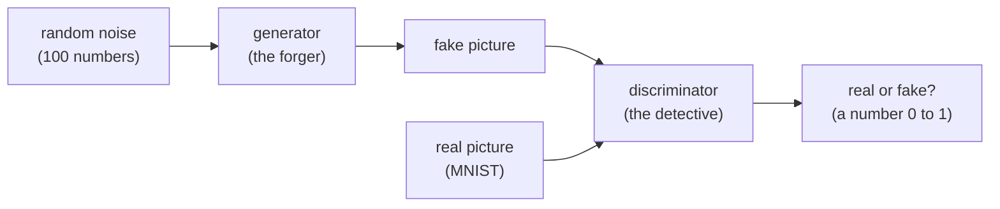
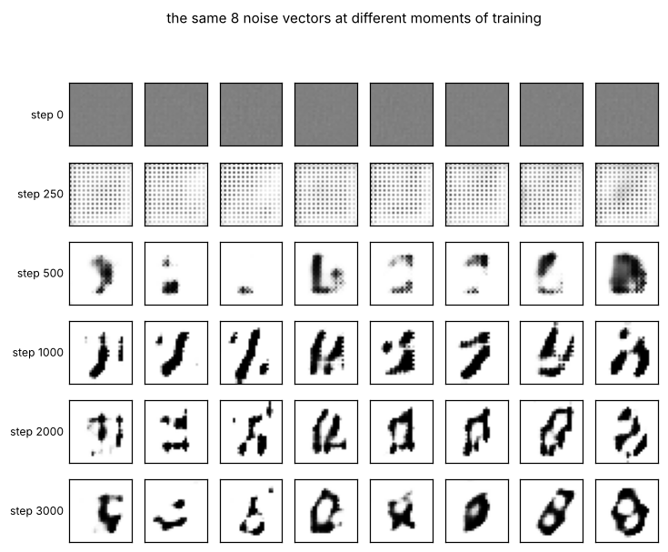
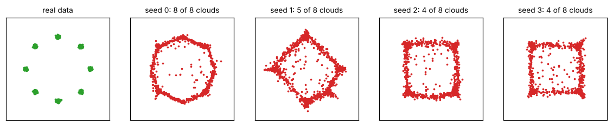

# GANs for handwritten digits: learn the forger-and-detective game step by step

> **After this tutorial you will be able to** explain how a GAN learns without being told what a good picture looks like,
> train a tiny GAN on numbers and a small one on MNIST digits, and read its first results honestly.

[](https://colab.research.google.com/github/maryammahmoudi1993/gan_Mnist/blob/main/notebooks/01_intuition_and_a_minimal_gan.ipynb)

> **Status:** both notebooks are ready.

## Who this is for

- **For:** learners who know basic Python and NumPy; the idea of a neural network helps but is not required.
- **Not needed:** a GPU, a maths degree, or your own data. Everything runs on a laptop CPU.
- **Time:** about 40 minutes for notebook 01 (about six minutes of training) and about 50 minutes for notebook 02 (about ten minutes of training).

## What you will learn

- The idea of a GAN as a game between a forger (generator) and a detective (discriminator), and the one formula behind it.
- How to watch the game on a toy problem with numbers before moving to pictures.
- How to build and train a small GAN for MNIST digits, and what the first pictures look like.
- Why GAN losses are not a normal learning curve. (01)
- How to follow a GAN with samples from fixed noise, loss curves and a measuring device (a digit classifier), and why none of them is enough alone. (02)
- What instability and mode collapse look like, counted over several seeds on a toy where the modes are known. (02)

## The pipeline in one picture



<p align="center">
  <br>
  <em>The same eight noise vectors at six moments of training: from grey static to rough, stroke-like shapes.</em>
</p>

## How to run

**In the browser (no installation):** click the Colab badge above. Colab already has TensorFlow;
the first cell downloads this repository for you.

**On your computer** (Python 3.13 was tested; any recent Python 3 that TensorFlow supports should work):

```bash
git clone https://github.com/maryammahmoudi1993/gan_Mnist.git
cd gan_Mnist
python -m venv .venv
source .venv/bin/activate
pip install -r requirements.txt
python -m ipykernel install --user --name python3
jupyter lab notebooks/
```

If `jupyter` is not found, run `pip install jupyterlab` first (it is not needed to run the tests).

Check that everything works (runs the smoke tests and every notebook, about sixteen minutes):

```bash
python -m pytest -q
```

The data (MNIST, about 11 MB) is downloaded automatically on the first run; see [`data/README.md`](data/README.md).

## Contents

| # | Notebook | You will learn | Status |
|---|---|---|---|
| 01 | [The forger and the detective: your first GAN](notebooks/01_intuition_and_a_minimal_gan.ipynb) | the game, a toy GAN on numbers, a small GAN on digits | ready |
| 02 | [Is it learning? Samples, loss curves, instability and mode collapse](notebooks/02_training_instability_and_mode_collapse.ipynb) | samples across training, loss curves that mislead, a classifier as a ruler, mode collapse and instability on a ring of eight clouds | ready |

Other folders: [`src/`](src) shared code, [`tests/`](tests) smoke tests and a test that runs every notebook,
[`legacy/`](legacy) the original 2022 files (untouched), [`assets/`](assets) figures and [credits](assets/CREDITS.md).

## Results so far

A GAN has no accuracy to report; what the notebooks show are measurements of the game and the pictures themselves.
All numbers come from running the notebooks (fixed seeds, CPU).

### Notebook 01 (seed 42, one run)

| Experiment | What was measured | Result |
|---|---|---|
| Toy game (numbers), 3,000 steps | mean and standard deviation of the generated numbers (real: 3.00 and 0.60) | 3.02 and 0.99: the mean matches, the spread is wider and the shape is not a bell |
| Toy game, last 200 steps | accuracy of the detective on real / fake numbers | 46% / 54%, loss 0.693 (a coin flip): a draw, although the spread is wrong |
| Digit GAN (width 32, batches of 64), 3,000 steps | accuracy of the detective on real / fake pictures in the last 300 steps | 60% / 61%, loss 0.665 (the forger's loss: 0.747) |
| Digit GAN, 3,000 steps | pictures from 8 fixed noise vectors | strokes and loops appear by step 1000 to 3000; most pictures are still not clean digits |

No image-quality score was computed. Three thousand steps (about three passes over the data) are far fewer than the 23,400 steps of the original script.

### Notebook 02 (digit GAN: 5,000 steps, seed 42; ring toy: 8 seeds)

| Experiment | Result |
|---|---|
| Digit GAN, loss curves | after about step 2,500 the curves are flat (detective's loss 0.66, accuracy about 60%), but the pictures keep changing |
| Digit GAN, classifier as a ruler (256 generated pictures per moment) | average confidence 0.54 (step 0), 0.81 (step 1000, peak), 0.75 (step 5000); real digits: 0.96 |
| Digit GAN, digits found by the ruler | 10 of 10 at steps 2000 and 5000, but uneven (57 of 256 read as a 9, 12 as a 4 at step 5000); no collapse to a few digits |
| Ring toy, 8 seeds, 6,000 steps: clouds covered (of 8) | 8, 5, 4, 4, 4, 6, 8, 7 (mean 5.75): all 8 reached in only 2 of 8 seeds |
| Ring toy, instability | the number of covered clouds went down in 20 of 88 consecutive measurements; some seeds peaked and then fell back |

<p align="center">
  <br>
  <em>Mode dropping and smoothing between the modes: the generator for seeds 0 to 3 reaches 8, 5, 4 and 4 of the eight clouds.</em>
</p>

## Learning journey

| | **Then (2022, in [`legacy/`](legacy))** | **Now** |
|---|---|---|
| Does it run? | the script stops with an error at epoch 10 (the function `noise_data` is passed where the number `noise_dim` belongs) | tested: smoke tests and every notebook run in CI |
| Structure | one script with global variables that stand in for function arguments | functions in `src/gan.py` with explicit arguments and a custom, documented training loop (two optimisers) |
| Size | 128 filters, 100 epochs (23,400 steps); not feasible on a CPU in a tutorial | 32 filters, 3,000 steps, stated clearly |
| Results | none shown; model files and pictures written to the working directory | losses, accuracies and pictures at fixed moments, from fixed noise, with a seed |
| Explanation | the README describes the code | a toy game with pictures, a formula with every symbol explained, and "what to notice" after every cell |

What I would do differently: start with a toy problem I can see, fix the seed, keep the same noise for every snapshot, and never write model files into the repository.
See [`legacy/ABOUT.md`](legacy/ABOUT.md) for what I notice in the original script today.

## Limitations

- Small networks and 3,000 steps: the digits are still rough. The notebook shows the idea, not a state-of-the-art generator.
- One seed per experiment; GAN training is chaotic, so other seeds will look different.
- No numerical quality measure (such as FID) is used; judging by eye is subjective.
- The plain GAN here cannot be asked for a specific digit.
- The digit classifier used as a ruler is crude (it can be confident about pictures that are not digits); mode collapse is measured on a toy, not on the digit GAN.
- Training uses deterministic settings and is therefore slower than it could be (about 0.1 s per step on four CPU cores).

## Further reading

- Goodfellow et al. (2014), *Generative Adversarial Nets*, NIPS 2014, <https://arxiv.org/abs/1406.2661>.
- Salimans et al. (2016), *Improved Techniques for Training GANs*, <https://arxiv.org/abs/1606.03498> (the Inception Score and minibatch discrimination).
- Arjovsky, Chintala and Bottou (2017), *Wasserstein GAN*, <https://arxiv.org/abs/1701.07875> (a different loss).
- Radford, Metz and Chintala (2015), *Unsupervised Representation Learning with Deep Convolutional Generative Adversarial Networks*, <https://arxiv.org/abs/1511.06434> (convolutional GANs).
- LeCun, Cortes and Burges, *The MNIST database of handwritten digits*, <http://yann.lecun.com/exdb/mnist/>.

## License

MIT, see [`LICENSE`](LICENSE). The MNIST data set has its own licence (Creative Commons Attribution-Share Alike 3.0), see [`data/README.md`](data/README.md).
